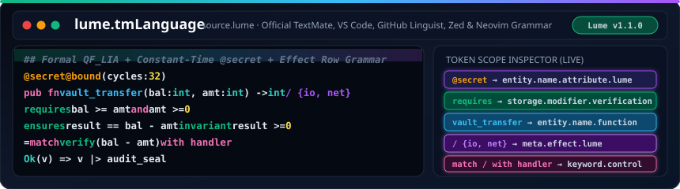

<h1>
  
  lume.tmLanguage — Official Syntax Highlighting &amp; Editor Grammar for Lume <code>v1.1.0</code>
</h1>
<br clear="left"/>

<div align="center">

[](https://github.com/OmegaSoftDLL/lume.tmLanguage/blob/main/syntaxes/Lume.tmLanguage.json)
[-38bdf8?style=for-the-badge)](https://github.com/OmegaSoftDLL/Lume)
[](https://github.com/OmegaSoftDLL/lume.tmLanguage/blob/main/docs/wiki/GitHub-Linguist-Integration.md)
[](https://github.com/OmegaSoftDLL/lume.tmLanguage/blob/main/docs/wiki/Editor-Integration-Guide.md)
[](LICENSE)

<br />



<br />

**[Official Portal](https://omegasoftdll.github.io/lume.tmLanguage/) · [Token Scopes Wiki](docs/wiki/Token-Scopes-and-Grammar.md) · [Editor Setup Guide](docs/wiki/Editor-Integration-Guide.md) · [GitHub Linguist Guide](docs/wiki/GitHub-Linguist-Integration.md) · [Projects & Roadmap](PROJECTS.md) · [Main Lume Repo](https://github.com/OmegaSoftDLL/Lume)**

</div>

---

## About `lume.tmLanguage` · Sobre o `lume.tmLanguage`

> **EN:** **`lume.tmLanguage`** is the official TextMate (`.tmLanguage.json`) lexical grammar and VS Code / Cursor / VSCodium / GitHub Linguist / Zed / Sublime Text / Neovim syntax-highlighting definition for **[Lume `v1.1.0`](https://github.com/OmegaSoftDLL/Lume)** — the 100% self-hosted (`stage2 == stage3`), formally verified (`QF_LIA` / `QF_NIA` / `WCET` / `@secret`), 9-ecosystem Chameleon polyglot programming language. It provides first-class semantic token scopes for `.lume` and `.src` files, including refinement contracts (`requires`, `ensures`, `invariant`, `law`, `verify`), capability effect rows (`/ pure`, `/ {io, net, ffi}`), compile-time attributes (`@secret`, `@bound`), algebraic handlers (`match ... with handler`), and hardened string interpolation (`f"hex={v:04x}"`).
>
> **PT-BR:** O **`lume.tmLanguage`** e a gramatica lexical TextMate (`.tmLanguage.json`) e extensao oficial de realce de sintaxe para **VS Code, Cursor, VSCodium, GitHub Linguist, Zed, Sublime Text e Neovim** da linguagem **[Lume `v1.1.0`](https://github.com/OmegaSoftDLL/Lume)**. Suporta arquivos `.lume` e `.src`, destacando com precisao contratos formais (`requires`, `ensures`, `invariant`, `law`, `verify`), linhas de efeito (`/ pure`, `/ {io, net, ffi}`), atributos de verificacao (`@secret`, `@bound`), handlers algebricos (`with handler`) e interpolacao de strings endurecida (`f"hex={v:04x}"`).

---

## Complete Token Scope Reference (`source.lume`)

| Token Category | TextMate Scope (`Lume.tmLanguage.json`) | Highlighted Language Constructs |
| :--- | :--- | :--- |
| **Formal Verification Contracts** | `storage.modifier.verification.lume` | `requires`, `ensures`, `invariant`, `law`, `verify` |
| **Capability & Effect Rows** | `meta.effect.lume` / `storage.modifier.effect.lume` | `/ pure`, `/ {io}`, `/ {io, net, fs}`, `/ {ffi}` |
| **Compiler & Security Attributes** | `meta.attribute.lume` / `entity.name.attribute.lume` | `@secret`, `@bound`, `@inline`, `@cold`, `@packed` |
| **Declarations & Module Items** | `storage.type.lume` | `fn`, `type`, `record`, `enum`, `error`, `trait`, `impl`, `const`, `mod`, `use`, `extern`, `effect`, `model`, `macro` |
| **Ownership & Purity Modifiers** | `storage.modifier.lume` | `pub`, `crate`, `own`, `mut`, `unsafe`, `total`, `par` |
| **Control Flow & Handlers** | `keyword.control.lume` | `if`, `then`, `elif`, `else`, `match`, `with`, `handler`, `resume`, `for`, `while`, `loop`, `in`, `return`, `defer`, `spawn`, `select` |
| **Bindings & Logical Connectives** | `keyword.declaration.lume` | `let`, `var`, `comptime`, `quote`, `unquote`, `splice`, `from`, `where`, `as`, `is`, `and`, `or`, `not` |
| **Function Definitions** | `entity.name.function.lume` | Function identifier immediately following `fn <name>` |
| **Primitive & Sovereign Types** | `storage.type.primitive.lume` | `bool`, `char`, `str`, `int`, `uint`, `float`, `decimal`, `i8`..`i128`, `u8`..`u128`, `f16`..`f64`, `never`, `Self` |
| **Algebraic & User Types** | `entity.name.type.lume` | `Cons`, `Nil`, `Option`, `Result`, `Verified`, `Unverified`, `[A-Z][A-Za-z0-9_]*` |
| **Built-In Runtime Intrinsics** | `support.function.builtin.lume` | `print`, `println`, `str`, `toint`, `readall`, `old`, `alloc`, `arena_new`, `arena_alloc`, `chan_new`, `chan_send`, `chan_recv` |
| **Strings & Hardened Interpolation** | `string.quoted.double.lume` / `meta.interpolation.lume` | `"..."`, `"""..."""`, `r"..."`, `re"..."`, `b"..."`, `{expr}`, `\u{...}` escapes |
| **Numeric Literals** | `constant.numeric.lume` | Decimal (`42_000`), Hex (`0xFF_00`), Binary (`0b1010`), Octal (`0o755`), Float (`3.14e-2`) |
| **Operators & Wrapping Math** | `keyword.operator.lume` | `\|>`, `->`, `=>`, `+%`, `-%`, `*%`, `+?`, `+\|`, `?.`, `??`, `..`, `..=`, `==`, `!=`, `<=`, `>=` |
| **Documentation & Block Comments** | `comment.line.documentation.lume` / `comment.block.lume` | `## Doc comment`, `# Line comment`, `#[ Nested block comment ]#` |

---

## Quick Installation Across Editors · Instalacao nos Editores

### 1. Visual Studio Code / Cursor / VSCodium

Clone or symlink `lume.tmLanguage` directly into your VS Code extensions directory:

**Linux / macOS / WSL2:**
```bash
git clone https://github.com/OmegaSoftDLL/lume.tmLanguage.git ~/.vscode/extensions/omegasoftdll.lume-tmlanguage-1.1.0
```

**Windows PowerShell:**
```powershell
git clone https://github.com/OmegaSoftDLL/lume.tmLanguage.git "$HOME\.vscode\extensions\omegasoftdll.lume-tmlanguage-1.1.0"
```

Reload VS Code (`Ctrl+Shift+P` -> `Developer: Reload Window`) and open any `.lume` or `.src` file!

### 2. GitHub Linguist (`.gitattributes` Override for Any Repository)

To enable GitHub syntax highlighting and language statistics for `.lume` and `.src` files in your repositories:

```gitattributes
*.lume linguist-language=Lume
*.src  linguist-language=Lume
```

### 3. Pairing with `lume lsp` & `lume dap` (Full IDE Experience)

Combine `lume.tmLanguage` lexical highlighting with the built-in Lume Language Server (`lume lsp`) and Debug Adapter (`lume dap`) from the [Lume `v1.1.0` toolchain](https://github.com/OmegaSoftDLL/Lume):

```bash
# Start the built-in Lume Language Server (JSON-RPC 2.0 over stdio: hover, QF_LIA diagnostics, go-to-definition)
lume lsp

# Start the built-in Lume Debug Adapter Protocol server
lume dap

# Format Lume source files canonically
lume fmt path/to/file.lume
```

---

## Repository Structure

| Path | Purpose |
| :--- | :--- |
| [`syntaxes/Lume.tmLanguage.json`](syntaxes/Lume.tmLanguage.json) | Canonical TextMate JSON grammar (`source.lume`) for `.lume` and `.src` |
| [`package.json`](package.json) | Ready-to-load VS Code / Cursor / VSCodium extension manifest |
| [`language-configuration.json`](language-configuration.json) | Auto-closing brackets, comment toggling (`#` / `#[ ]#`), and indentation rules |
| [`docs/wiki/`](docs/wiki/Home.md) | 5-page documentation wiki (Token Scopes, Editor Setup, GitHub Linguist, Tests) |
| [`PROJECTS.md`](PROJECTS.md) | Engineering roadmap & editor ecosystem matrix |

---

<div align="center">
  <sub>
    <b>lume.tmLanguage v1.1.0</b> · Official Syntax Grammar for <a href="https://github.com/OmegaSoftDLL/Lume">Lume</a> · Maintained by <b>Ricardo Bueno (<code>@OmegaSoftDLL</code>)</b> &amp; <b>LumeLabs</b> · Licensed under <a href="LICENSE">MIT</a>
  </sub>
</div>
