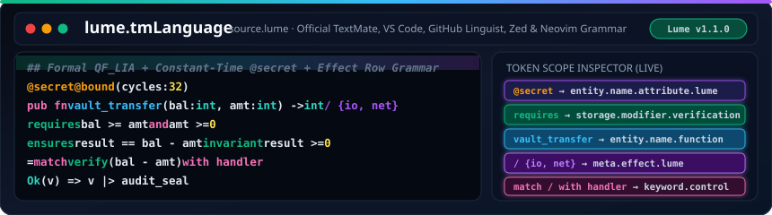

<h1>
  
  lume.tmLanguage — Official Documentation Portal
</h1>
 

  

---

Welcome to the official **`lume.tmLanguage`** documentation portal for **[Lume `v1.1.0`](https://github.com/OmegaSoftDLL/Lume)**.

- **[Wiki Home](wiki/Home.html)**
- **[Token Scopes & Grammar Reference](wiki/Token-Scopes-and-Grammar.html)**
- **[Editor Integration Guide (VS Code, Zed, Sublime, Neovim)](wiki/Editor-Integration-Guide.html)**
- **[GitHub Linguist Integration](wiki/GitHub-Linguist-Integration.html)**
- **[Contributing & Grammar Tests](wiki/Contributing-and-Tests.html)**
