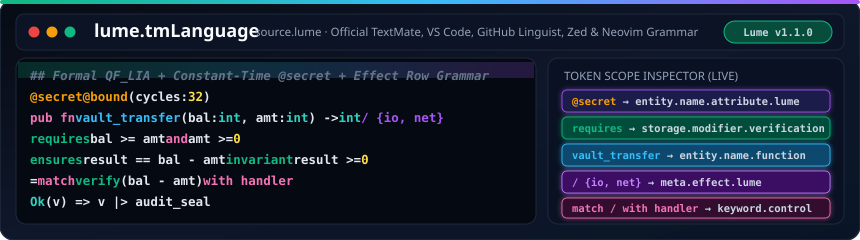

<h1>
  
  lume.tmLanguage — Official Wiki Home
</h1>
 

  

---

## Wiki Navigation

1. **[Token Scopes & Grammar Reference](Token-Scopes-and-Grammar)** — Complete breakdown of all TextMate scopes (`source.lume`) in `syntaxes/Lume.tmLanguage.json`.
2. **[Editor Integration Guide](Editor-Integration-Guide)** — Step-by-step setup for VS Code, Cursor, VSCodium, Zed, Sublime Text, Neovim, and `lume lsp`.
3. **[GitHub Linguist Integration](GitHub-Linguist-Integration)** — Configuring `.gitattributes` and Linguist overrides for `.lume` and `.src` repositories.
4. **[Contributing & Grammar Tests](Contributing-and-Tests)** — Regex safety rules (zero catastrophic backtracking), pure LF hygiene, and scope verification.
